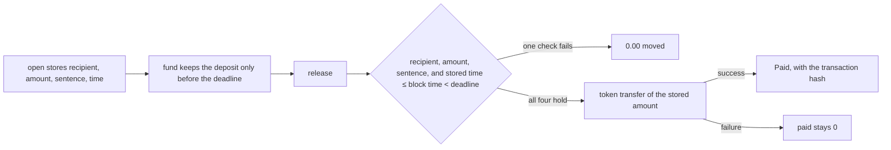

# Meter

Meter enforces the stored line. It does not judge the work. The parties choose the time, and the contract enforces stored time ≤ block time < deadline.

A buyer and a vendor already agreed one price. On the recorded run that price is **48.00** of a testnet token, for one sentence. Two companies can write a ceiling and a floor. The sheet shows the price, the recipient, the sentence, and the deadline. The overlap of those two numbers is computed in the browser. It is not an enclave, and a failed overlap creates no meter. A normal transfer would pay whoever is named when it is sent. This contract pays the stored line inside that window, or it moves nothing.

This is a second project beside [Accord](https://github.com/Adityaakr/accord). The screen is one invoice, not a room with tabs.


## Contents

1. [Sixty seconds](#1-sixty-seconds)
2. [The problem](#2-the-problem)
3. [How it works](#3-how-it-works)
4. [What is proven, and where it stops](#4-what-is-proven-and-where-it-stops)
5. [Evidence](#5-evidence)
6. [Try it](#6-try-it)
7. [Decisions](#7-decisions)
8. [Stack](#8-stack)
9. [Getting started](#9-getting-started)
10. [Repo map](#10-repo-map)
11. [Status](#11-status)
12. [Roadmap](#12-roadmap)
13. [Team and license](#13-team-and-license)

## 1. Sixty seconds

| | |
| --- | --- |
| Cluster | NEAR testnet. The token is `token.mtrfc658fd1.testnet`. It is not Circle USDC. |
| Current contract | [`m1870dd.mtrfc658fd1.testnet`](https://testnet.nearblocks.io/address/m1870dd.mtrfc658fd1.testnet) |
| The line | 48.00 to `u7bc2f8.mtrfc658fd1.testnet`, sentence "Field report 04, price column at most 100" |
| Where to click | On the homepage, open **Try the refusal** and choose **Before the time**. The code is `ERR_NOT_YET` and 0.00 would move. That page sends no transaction. |
| What is real | Three testnet contracts, re-read by `node chain/verify.mjs`. The homepage preview and the desk are a browser copy of the same branches. A Clears mark there has no hash. |
| What is absent | No accept button, no wallet connect, no owner withdraw, no checked Intel quote, no mainnet. |

## 2. The problem

A transfer pays the account named at send time. An invoice that can be edited after both sides signed is the same hole: the recipient, the amount, or the sentence can move, and the money follows the edit.

On 10 Nov 2026 the payment record named `other.testnet` instead of the sealed recipient. The contract recorded `ERR_RECIPIENT` and moved 0.00. The sealed line then paid 48.00. Hashes are in [Evidence](#5-evidence).

The first time-gate contract paid as soon as it was funded. The current one will not: the release has to land at or after the stored time, and before the deadline.

## 3. How it works



1. `open` stores the recipient, the amount, the sentence, and the window. No later method writes those fields.
2. `fund` accepts the stored token. A deposit at or after the deadline is rejected and the balance stays where it was.
3. `release` pays only when the caller is the stored recipient, the amount is the stored amount, the sentence hashes to the stored evidence, and stored time ≤ block time < deadline.
4. The transfer uses the stored recipient and the stored amount. `paid` is set in the callback only after that transfer succeeds.

The paying key can call `release` and nothing else. Its allowance is 0.50 NEAR, for gas. A function-call key cannot attach a deposit. Five refusals delete it. Once the stored time has arrived, that key can pay immediately, and a delete loses if the payment lands first. The line is what the money follows.

The browser preview calls `decide` in `app/lib/rule.mjs`. It does not call `release`. A second click cannot move money, because the preview never sends a transaction.

## 4. What is proven, and where it stops

| Claim | Why it holds | Where it stops |
| --- | --- | --- |
| The line cannot be edited after open | `open` stores recipient, amount, sentence, and window. No method writes them again. | The parties choose the line before open. The contract does not judge whether the work was done. |
| Payment waits for the stored time | `release` returns `ERR_NOT_YET` while block time is before `not_before_ns`, and `ERR_TOO_LATE` at the deadline. One nanosecond before the deadline still clears. Unit test: `one_nanosecond_before_the_deadline_clears_and_the_deadline_does_not`. | The desk clock is not block time. The preview clock is the number on the chip. |
| A failed check moves nothing | Wrong recipient, wrong amount, rewritten sentence, early call, and the deadline each leave `paid` at 0. The recorded hashes are below. | A Clears mark on the desk or the homepage has no hash. Editing browser storage cannot create a Paid figure. |
| Paid means the transfer succeeded | On `contract-v2`, `paid` is set in the callback. The unregistered recipient's first release moved 0.00. | The older payment record and the signed release set `paid` before `ft_transfer` and roll it back only if the promise fails. |
| The paying key is narrow | It can call `release` only, with a 0.50 NEAR allowance. A function-call key cannot attach a deposit. `install_agent` and `revoke_agent` require 1 yoctoNEAR, so that key cannot call them. Five recorded refusals delete it. The unregistered-recipient failure is a transfer failure, not one of those five. | Once the stored time has arrived, a delete loses if the payment lands first. On the payment record the buyer deleted the key after three refusals, rather than waiting for the fifth. The allowance is gas, not the invoice. |
| A late deposit is rejected | On `m1870dd`, meter 2's deposit at the deadline returned `ERR_TOO_LATE` and `funded` stayed 0. | `m718aa2.mtrfc658fd1.testnet` is an earlier time gate. It does not reject a late deposit, and it hashes the evidence hex rather than the sentence. |
| The refund returns the balance to the buyer | Anyone may call `refund` after the deadline, and only if nothing was paid. It pays the stored buyer. A second success is refused. A refund before the deadline is `ERR_TOO_EARLY`. The payment-record refund is on chain. | The time-gate refund is unit-tested only. Meter 1 on `m1870dd` was paid before its deadline, so that path has no chain receipt. The desk clock is not NEAR block time. |
| The signature matches the line | The signed release paid 48.00 when the signature matched. | The Intel quote was not checked. The model repeated a line this repo wrote. A matching signature pays as soon as that meter is funded. |

## 5. Evidence

`node chain/verify.mjs` re-reads all three contracts. It uses no key. It prints `verify: ok` when the three accounts still match these files, including the recomputed line hash `c3bed004db7244d5` and the token `token.mtrfc658fd1.testnet`. JSON numbers lose precision on these nanosecond fields, so the check reads `not_before_ns` and `deadline_ns` from the raw response.

### Time gate

Contract [`m1870dd.mtrfc658fd1.testnet`](https://testnet.nearblocks.io/address/m1870dd.mtrfc658fd1.testnet). Recorded 2026-11-11 11:19 UTC. Receipts: `app/public/v2.json`, `chain/v2-receipt.json`.

Line hash `c3bed004db7244d51d2fb2d130cdfe25c94a3eebcf7944a66e65d04f817ee980`. The last field is the sentence in Unicode NFC, not the evidence hex. Amount `48000000` (6 decimals, shown as 48.00). A decimal such as `48.00` is not a value the hash accepts. `not_before_ns` `1794395956334573568`. `deadline_ns` `1794402976334573568`.

NEAR time is nanoseconds, not blocks. `open` rejects a time that is already past, and a time that is not before the deadline. `sign` is a call from the buyer's or the vendor's own account. It stores approval of the line hash. It is not a detached signature. The token account is stored at `new`, `token()` returns it, and a transfer from any other token is rejected. The parties choose the gap. A one-second gap is a weak gate they chose.

| What happened | Code | Moved | Transaction |
| --- | --- | --- | --- |
| Before the stored time | `ERR_NOT_YET` | 0.00 | [`6jEC64QsURimyDBAFEjzkakmBJsU1D4hE8WiwMxk75ia`](https://testnet.nearblocks.io/txns/6jEC64QsURimyDBAFEjzkakmBJsU1D4hE8WiwMxk75ia) |
| Recipient not registered | `ERR_TRANSFER` | 0.00 | [`EDasWtLXYPKGRRMU6Ng9t4Qu3XHw1L4XXFw282wtFyGk`](https://testnet.nearblocks.io/txns/EDasWtLXYPKGRRMU6Ng9t4Qu3XHw1L4XXFw282wtFyGk) |
| After the time, same line | `OK` | 48.00 | [`BBhEfuMFX18t4TPMfs1ppbiL3D3kv4H4N4vy65vBMQDU`](https://testnet.nearblocks.io/txns/BBhEfuMFX18t4TPMfs1ppbiL3D3kv4H4N4vy65vBMQDU) |
| Second release | `ERR_ALREADY_PAID` | 0.00 | [`2juziMHKrrukZG3GmqSfBqBXXeBQWFnAB1yWZTb1wxb3`](https://testnet.nearblocks.io/txns/2juziMHKrrukZG3GmqSfBqBXXeBQWFnAB1yWZTb1wxb3) |
| Buyer revoked the key | `OK` | 0.00 | [`2tyHhLwu8L4cS98MdUTBSba4mnepyz7JYXxV6F6k1UE1`](https://testnet.nearblocks.io/txns/2tyHhLwu8L4cS98MdUTBSba4mnepyz7JYXxV6F6k1UE1) |
| Deposit at the deadline, meter 2 | `ERR_TOO_LATE` | funded stayed 0 | [`GBzsHNTMSRSwhHPQeRAUiEB9meJAPguksmPY7bwBSJUU`](https://testnet.nearblocks.io/txns/GBzsHNTMSRSwhHPQeRAUiEB9meJAPguksmPY7bwBSJUU) |

The unregistered release is expected. The token traps with `ERR_NOT_REGISTERED`, and the callback records `ERR_TRANSFER`. `paid` stays 0. That refusal does not count toward the five-refusal tripwire.

`contract-v2/src/v3.rs` unit-tests a pool and a condition. Those are not methods on the deployed contract. `m718aa2.mtrfc658fd1.testnet` is the earlier time gate and is not this claim.

### Payment record

Contract [`m028a47.mtrfc658fd1.testnet`](https://testnet.nearblocks.io/address/m028a47.mtrfc658fd1.testnet). Recorded 2026-11-10 23:03 UTC. Receipt: `app/public/chain.json`. This contract has no stored release time. Do not redeploy the current time-gate build onto this account.

| What happened | Code | Moved | Transaction |
| --- | --- | --- | --- |
| Wrong account | `ERR_RECIPIENT` | 0.00 | [`DrPqTQnWZSF94vfG8dyg1cPe1vgDxPuW1C7Yh5rjHdVX`](https://testnet.nearblocks.io/txns/DrPqTQnWZSF94vfG8dyg1cPe1vgDxPuW1C7Yh5rjHdVX) |
| Wrong amount | `ERR_AMOUNT` | 0.00 | [`CLJXCAbMm4qs37Wp7sKCYFz6ezS7F6f1kKMC2L2CYQG2`](https://testnet.nearblocks.io/txns/CLJXCAbMm4qs37Wp7sKCYFz6ezS7F6f1kKMC2L2CYQG2) |
| Evidence changed | `ERR_EVIDENCE` | 0.00 | [`HxBaTriUzgt81fpVQ9moJvuMqUdYJwzF4oajZqWqKdAj`](https://testnet.nearblocks.io/txns/HxBaTriUzgt81fpVQ9moJvuMqUdYJwzF4oajZqWqKdAj) |
| Sealed line | `OK` | 48.00 | [`BGX34Gq1NRv17qNtdBy2pcFqszP5V1AzBfpxy7bwveSt`](https://testnet.nearblocks.io/txns/BGX34Gq1NRv17qNtdBy2pcFqszP5V1AzBfpxy7bwveSt) |
| Key revoked | `OK` | 0.00 | [`HL7KXwCNYgdeMkg5oJ3ttkjUFPFgJ6Lx9YxeKxMhkRfg`](https://testnet.nearblocks.io/txns/HL7KXwCNYgdeMkg5oJ3ttkjUFPFgJ6Lx9YxeKxMhkRfg) |
| Same key after delete | `AccessKeyDoesNotExist` | — | No transaction. The key was already gone. |
| Late release, meter 2 | `ERR_TOO_LATE` | 0.00 | [`GZvzNMQgNzSM69BDQXzch8RB34ip8fFcKysQAuFVAEQq`](https://testnet.nearblocks.io/txns/GZvzNMQgNzSM69BDQXzch8RB34ip8fFcKysQAuFVAEQq) |
| Refund to the buyer | `OK` | 48.00 | [`3MuQnuUxot9ZxNqvrfeFTRVW753JjBHfzUPzsu3RBsmj`](https://testnet.nearblocks.io/txns/3MuQnuUxot9ZxNqvrfeFTRVW753JjBHfzUPzsu3RBsmj) |
| Deadline key deleted | `OK` | 0.00 | [`2pJ1s5Lm8tk9eacrxQ8cSSXJDDYYQJ1z3iPy5JZBbF78`](https://testnet.nearblocks.io/txns/2pJ1s5Lm8tk9eacrxQ8cSSXJDDYYQJ1z3iPy5JZBbF78) |

The two 48.00 payments are different runs. The time-gate row is labeled "After the time." This row is labeled "Sealed line."

### Signed release

Contract [`m2b2440.mtrfc658fd1.testnet`](https://testnet.nearblocks.io/address/m2b2440.mtrfc658fd1.testnet). Model `z-ai/glm-5.3-flash`. Pinned signer `0x3b753b4406613c5e70ae640508632b600424fa0c`. Receipts: `app/public/tee.json`, `chain/tee-release.json`.

| What happened | Code | Moved | Transaction |
| --- | --- | --- | --- |
| Signature did not match the line | `ERR_ATTEST_LINE` | 0.00 | [`EQzQ5NRzoxLdBSjgk6cjJD5eJCenrEW5rc6hTs1YnR4u`](https://testnet.nearblocks.io/txns/EQzQ5NRzoxLdBSjgk6cjJD5eJCenrEW5rc6hTs1YnR4u) |
| Matching signature | `OK` | 48.00 | [`FjVb3vTXkQHYSbiWMEwkTzdDxY1o72sTq7cmbtpitCP`](https://testnet.nearblocks.io/txns/FjVb3vTXkQHYSbiWMEwkTzdDxY1o72sTq7cmbtpitCP) |
| Key revoked | `OK` | 0.00 | [`HVVXnFMz8sqnYxrcGDy6voyX3gjX6ng85No9WZrTyDFS`](https://testnet.nearblocks.io/txns/HVVXnFMz8sqnYxrcGDy6voyX3gjX6ng85No9WZrTyDFS) |

Access keys on that account: 0. `release` on this contract also requires a `provider_tee` signature. The request and the response must both contain the release line. A matching signature pays as soon as the meter is funded. This check is not part of the time-gate contract. The Intel quote was not checked. The model repeated a line this repo already wrote.

The vendor account's token balance is 144.00. An earlier run paid 48.00, the payment record added 48.00, and the signed release added 48.00. The time-gate payment went to a fresh account, `u7bc2f8.mtrfc658fd1.testnet`, not to that vendor. `mint` on `token.mtrfc658fd1.testnet` is public and capped. It is not Circle USDC.

## 6. Try it

There is no SDK and no API. Two ways to use the rule:

**In the browser.** `npm run dev` from `app/`, then open the homepage. **Try the refusal** calls `decide` and labels the answer Clears or Stops. The same component is on `/clause`. Neither page sends a transaction.

**On the contract.** Read methods take no key. A write needs the buyer account and is not part of getting started. The methods that matter are `open`, `fund` (via the token's `ft_transfer_call`), `release`, `refund`, `install_agent`, and `revoke_agent`. `release` pays the stored line or moves nothing.

```bash
node chain/verify.mjs
```

Expected last line: `verify: ok`. The command reads public RPC state. It does not sign and it does not spend.

## 7. Decisions

<details>
<summary>The time is stored on the line, and no method can move it earlier.</summary>

The first funded meter could be paid the moment the deposit landed. The fork was a person's accept click, or a time written at `open`. The contract stores `not_before_ns` and `deadline_ns` and refuses a release outside that window. The incident is the superseded account `m718aa2`: it proved the early refusal and the later payment, and it still accepts a late deposit. `m1870dd` is the claim.
</details>

<details>
<summary>Paid is written after the transfer, not before it.</summary>

The token rejects an unregistered recipient by trapping. If `paid` were set first, a failed transfer could still look like a payment until the callback rolled it back. On `contract-v2`, `begin_release` does not set `paid`. The callback sets it only when the promise succeeds. The recorded proof is the `ERR_TRANSFER` row, 0.00, then the later 48.00 on the same meter.
</details>

<details>
<summary>The sentence is hashed, not a hex string the caller passes through.</summary>

The line hash's last field is the sentence in Unicode NFC. `sha256` of that sentence has to equal the evidence hex stored at open. The earlier time gate hashed the hex the caller supplied, so a different sentence could still match. That is one reason `m718aa2` is not the claim.
</details>

<details>
<summary>The desk says Clears. The chain says Paid only when a step has a hash.</summary>

A browser can store anything. The preview and the desk run `decide` locally and never receive a transaction hash. Calling a local clear "Paid" would let a judge treat an edit of browser storage as a payment. The tally counts a Paid figure only when the receipt step has a hash and the amount moved is greater than 0.
</details>

<details>
<summary>Pool and condition stay in a test file.</summary>

A pool needs more than one buyer and more than one balance. The deployed meter is one buyer and one funded amount. `contract-v2/src/v3.rs` is compiled only for tests. It is not in the wasm a judge re-reads on `m1870dd`.
</details>

## 8. Stack

| Layer | Choice | Why |
| --- | --- | --- |
| Contracts | Rust, `near-sdk` 5.30.0, `near-sys` 0.4.0 | The three recorded accounts are NEAR contracts. The time gate does not enable the `unstable` feature and does not verify a TEE quote. |
| Hashing | `sha2` 0.10, `unicode-normalization` 0.1 | The line hash has to match in Rust and in `chain/line.mjs`. |
| App | Next.js 15.5.4, React 19.1.1 | The page is a reader for the three receipts plus a local preview. No wallet library. |
| Rule shared with the page | `app/lib/rule.mjs` | The homepage and `/clause` call this function. They do not keep a second copy of the checks. |
| Chain reads | `chain/verify.mjs` against `https://test.rpc.fastnear.com` | A judge can re-read the accounts without a key. |
| CI | GitHub Actions, Node 20 | `.github/workflows/check.yml` runs the rule tests and the line-hash tests. It does not run `cargo test` and it does not run `verify.mjs`. |

## 9. Getting started

The app runs with no key and no paid service. Proving scripts that sign are separate, and they read `.keys/`, which is not committed.

| Tool | Version used here | Check |
| --- | --- | --- |
| Node.js | 20 in CI | `node -v` |
| npm | the one shipped with that Node | `npm -v` |
| Rust | edition 2021, for contract tests | `rustc --version` |

```bash
cd app
npm install
npm run dev
```

Open `http://localhost:3000`. **Try the refusal** is already on **Before the time**. The answer is `ERR_NOT_YET` and 0.00. The page does not ask for a wallet.

Open the desk, then **Continue in this browser**. That writes a tab name into `sessionStorage`. The name cannot sign. The desk repeats the recorded figures. Slips sealed from `/new` follow the same rule and move no tokens. Pay a different recipient shows `ERR_RECIPIENT` and 0.00. The time gate on the desk reads 48.00 cleared, 0.00 sent back, and 4 stopped lines. The payment record reads 48.00 cleared, 48.00 sent back, and 4 stopped lines. The signed release reads 48.00 cleared, 0.00 sent back, and 1 stopped line.

| Name | Required | Example | What it does |
| --- | --- | --- | --- |
| none for the app | no | — | `npm run dev` serves the receipts already in `app/public/`. |
| `.keys/testnet.json` | only to re-sign a run | not committed | Buyer and vendor secrets for `chain/v2-prove.mjs`. Do not commit this file. |

```bash
node --test app/lib/rule.test.mjs chain/line.test.mjs
(cd contract && cargo test)
(cd contract-tee && cargo test)
(cd contract-v2 && cargo test)
node chain/verify.mjs
```

The node command is what CI runs. `contract/src/rule.rs` is the payment-record rule. `contract-v2` covers the window, the late deposit, the unregistered transfer, and the test-only pool file. `verify.mjs` needs a network path to NEAR testnet. `node chain/prove.mjs` deploys a fresh payment-record contract. `FORCE=1 node chain/v2-prove.mjs` deploys another time gate. Neither is required to read the recorded runs.

> [!WARNING]
> `npm test` inside `app/` runs `lib/rule.test.mjs` only. The line-hash tests live in `chain/` and are not part of that script. Use the command in the block above from the repo root.

> [!TIP]
> If the homepage says the receipt did not load, the dev server is not serving `app/public/v2.json`. Start it from `app/`, not from the repo root.

> [!WARNING]
> `node chain/v2-prove.mjs` deploys a new contract when `FORCE=1` and `app/public/v2.json` already exists. Do not point it at `m028a47` or `m2b2440`.

## 10. Repo map

| Path | What it is |
| --- | --- |
| [`contract-v2/`](contract-v2) | The time-gate contract. This is the wasm on `m1870dd`. |
| [`contract/`](contract) | The payment-record contract. No stored release time. |
| [`contract-tee/`](contract-tee) | The signed release. Quote check is not in this build. |
| [`chain/`](chain) | Prove, late-deposit, and verify scripts, plus the receipt copies. |
| [`app/`](app) | The Next.js reader, the desk, and the preview. |
| [`app/public/`](app/public) | `chain.json`, `tee.json`, `v2.json`. The page reads these. |

<details>
<summary>Files a second reader opens first</summary>

```text
contract-v2/src/lib.rs     time gate, pay-then-mark, late deposit
contract-v2/src/v3.rs      pool and condition tests, not in the wasm
app/lib/rule.mjs           decide(), the preview's only rule
app/components/LinePreview.tsx
app/app/page.tsx           homepage: receipts, then the preview
chain/verify.mjs           re-reads the three accounts
chain/line.mjs             the same line hash as the contract
```

</details>

## 11. Status

<details open>
<summary>Observed working</summary>

| What | Evidence |
| --- | --- |
| Release before the stored time moves 0.00 | `ERR_NOT_YET`, tx `6jEC64Qs…` |
| Unregistered recipient moves 0.00, then the same line pays 48.00 | `ERR_TRANSFER` then `OK`, txs `EDasWtLX…` and `BBhEfuMF…` |
| Deposit at the deadline is rejected | `ERR_TOO_LATE`, meter 2, `funded` stayed 0 |
| Wrong recipient, wrong amount, and rewritten evidence move 0.00 | payment record, 10 Nov 2026 |
| Signed release pays only when the signature matches the line | `ERR_ATTEST_LINE` then 48.00 |
| Paying key removed | access-key list length 0 on the time-gate account after revoke |
| Preview uses the shared rule | homepage **Try the refusal** and `/clause` both render `LinePreview` |

</details>

<details>
<summary>Built, not observed end to end</summary>

- Time-gate refund. The method exists and the unit test passes. Meter 1 was paid before its deadline, so there is no chain receipt for that refund.
- Pool and condition. Tested in `contract-v2/src/v3.rs`. Not methods on the deployed contract.
- Desk slips. They follow `decide` and show Clears. They move no tokens and have no hash.

</details>

<details>
<summary>Deliberately absent</summary>

- An accept method. The parties choose the time. The contract enforces the window.
- A detached-signature release. `sign` is an account call that stores approval of the line hash. There is no detached signature to replay.
- A domain proof or a market-making observer. The overlap of a ceiling and a floor stays in the browser.
- Pool and condition methods on the wasm a judge re-reads.
- Wallet connect. The desk name is a tab id.
- A checked Intel quote, Circle USDC, an owner withdraw, and one account per meter. `open` on one contract holds many meters. `new(token)` stores the token. No full-access key is added, so the account cannot upgrade the code.

</details>

<details>
<summary>Open engineering work</summary>

- Mainnet after an audit. These runs are testnet.
- CI does not run `cargo test` or `node chain/verify.mjs`.
- The time-gate refund has no chain receipt.
- <!-- TODO: deploy a public URL. The app is local. `npm run dev` serves it at http://localhost:3000. -->
- <!-- TODO: a short GIF of Before the time returning ERR_NOT_YET. docs/home.jpg is a still of the first screen. -->

</details>

## 12. Roadmap

1. A public URL for the same build, so a judge does not need to clone. Blocked on hosting, not on a new rule.
2. A chain receipt for the time-gate refund, on a meter that is funded and not paid. Blocked on opening that meter. It does not change the rule.
3. Third-party audit, then a decision about mainnet. Blocked on the audit. The contract has no owner withdraw today.
4. CI that also runs `cargo test` and `node chain/verify.mjs`. Blocked on giving the workflow a network path and a Rust toolchain. The rule tests already run.

## 13. Team and license

<!-- TODO: names, roles, and a contact. The git history starts at cfc4f81 on 10 Nov 2026. -->

Contributing: open an issue on [github.com/datharnu/Meter](https://github.com/datharnu/Meter). Do not commit `.keys/`.

License: [MIT](LICENSE).

The three receipts were recorded on NEAR testnet. The token contract is the one in `contract/token`. Accord is a separate submission.

---

Meter. The sealed line is paid, or nothing moves.

<!-- TODO: hackathon name, track, and rules URL. Do not guess the judging criteria. -->

[Back to top](#meter)
